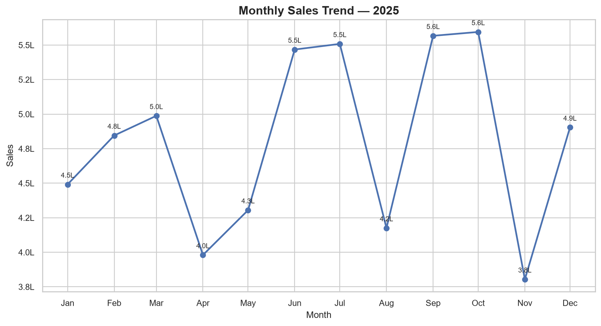
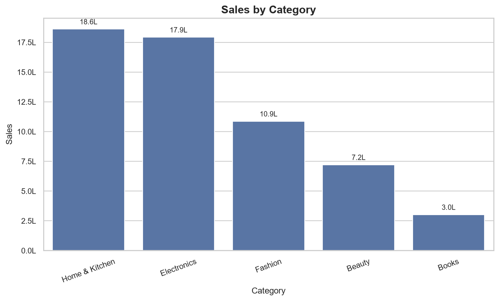
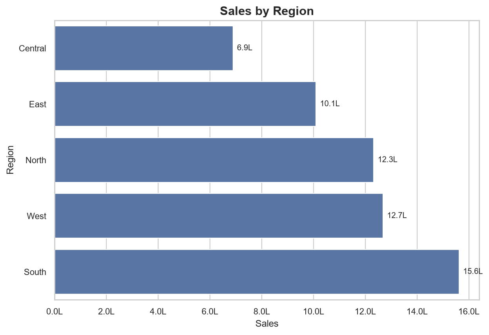
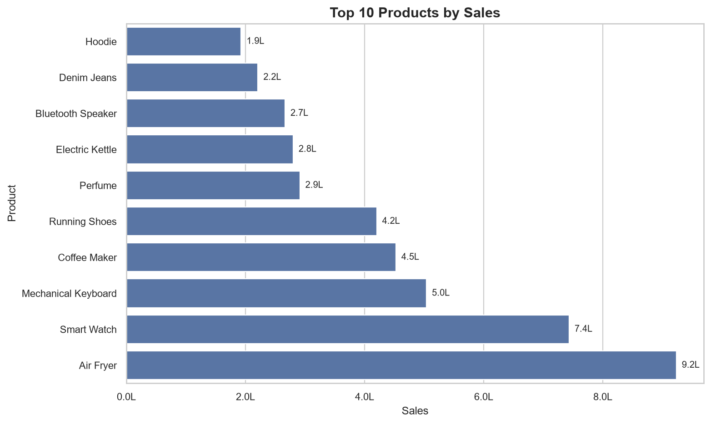
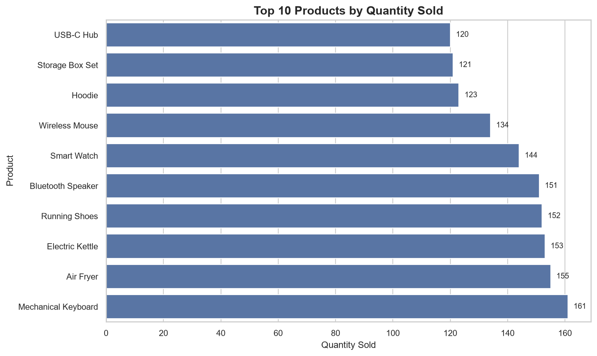
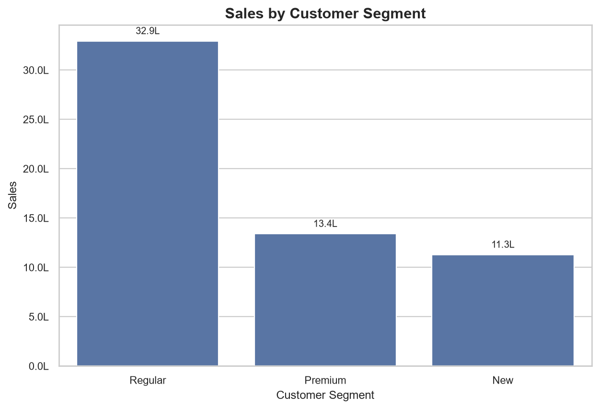

# E-Commerce Sales Analysis

## Project overview

This portfolio project looks at sales and customer activity in a synthetic e-commerce dataset. It uses Excel and Python for analysis, includes MySQL queries for the same questions, and documents a Power BI dashboard that has not yet been built.

## Business question

Which months, products, regions, and customer segments account for the most sales, and what should be checked before using those differences to make business decisions?

## Dataset

The project uses the synthetic [`ecommerce_sales.csv`](data/ecommerce_sales.csv), created for portfolio practice rather than taken from a real company. It has 1,500 orders across 12 columns, covering January 1 through December 31, 2025. The companion [`ecommerce_sales.xlsx`](data/ecommerce_sales.xlsx) contains the same source data, and [`data_dictionary.xlsx`](data/data_dictionary.xlsx) describes its columns.

The dataset does not identify a currency, so sales figures are shown without a currency symbol. Python chart labels use `L` for lakh units. This is one year of synthetic data; the monthly differences do not establish a recurring seasonal pattern. The data also does not include costs or profit, so sales totals alone cannot show margins.

## Tools

- Excel workbook with formula-based checks, summary metrics, PivotTables, and charts
- Python with pandas, NumPy, Matplotlib, and Seaborn
- MySQL-compatible SQL for data checks and grouped sales queries
- Power BI build guide; the `.pbix` dashboard is not included

## Project files

```text
dashboard/
  PowerBI_Build_Guide.md
data/
  data_dictionary.xlsx
  ecommerce_sales.csv
  ecommerce_sales.xlsx
excel/
  E-Commerce_Sales_Analysis.xlsx
python/
  ecommerce_sales_analysis.py
screenshots/
  excel_charts.png
  monthly_sales.png
  sales_by_category.png
  sales_by_customer_segment.png
  sales_by_region.png
  top_products.png
  top_products_by_quantity.png
sql/
  ecommerce_sales_analysis.sql
interview_questions.md
project_validation.md
requirements.txt
resume_project_description.md
```

## Data checks

The Python analysis checks that the required columns are present, the CSV has rows, there are no missing values or duplicate order IDs, and each `Sales` value matches `Quantity × Unit_Price × (1 - Discount)`. It also checks that quantities and unit prices are positive, discounts are between zero and one, and sales are not negative. It reports the date range and numeric summaries. The supplied dataset passes these checks; no rows were removed.

The Excel workbook includes a data-check sheet and formula-based summary. Its cached headline results agree with the CSV. The SQL contains corresponding queries, but has not been run in MySQL.

## Findings

- The dataset totals **5,763,218.70** in sales across **1,500 orders** and **348 customers**. Average order value is **3,842.15**.
- Home & Kitchen has the highest category sales (**1,860,988.10**), followed by Electronics (**1,792,523.15**).
- South has the highest regional sales (**1,562,410.25**); Central has the lowest (**689,343.75**).
- October is the highest-sales month (**559,499.70**) and November the lowest (**380,431.85**). The one-year dataset cannot establish whether this pattern repeats.
- Air Fryer has the highest product sales (**923,447.95**). Mechanical Keyboard has the highest quantity sold (**161**).
- The Regular segment has the highest sales (**3,294,207.15**). UPI is the most-used payment method (**631 orders**).

These results describe this dataset only. Before changing inventory or promotions, I would also compare profit margins, stock levels, and more years of data.

## Run the Python analysis

From the project directory, create and activate a virtual environment, then install the listed dependencies:

```powershell
python -m venv .venv
.\.venv\Scripts\Activate.ps1
python -m pip install -r requirements.txt
python python/ecommerce_sales_analysis.py
```

The script prints data checks and summary tables, then saves six charts in `screenshots/`. It also opens the charts when run in a graphical session.

## Run the SQL queries

The script in [`ecommerce_sales_analysis.sql`](sql/ecommerce_sales_analysis.sql) uses MySQL syntax. In MySQL Workbench, run its database and table creation statements first. Import `data/ecommerce_sales.csv` into the resulting `ecommerce_sales` table with the CSV headers and column order intact, then run the data-check and analysis queries. They have not been executed as part of this project review.

## Outputs

The Excel workbook contains five embedded charts; [`excel_charts.png`](screenshots/excel_charts.png) shows them together. The Python script produces these charts from the CSV:













## Current limitations and next steps

- The MySQL queries still need to be run against the imported CSV.
- The Power BI dashboard has not been created or tested. Follow the [build guide](dashboard/PowerBI_Build_Guide.md) to create the `.pbix` and compare its KPI cards with the figures above.
- The Excel workbook structure, formulas, charts, PivotTables, and cached summary values were inspected, but the workbook was not recalculated or refreshed in Excel during this review.
- The dataset covers one synthetic year and has no currency, cost, or margin fields. More data would be needed to assess seasonality or profitability.
